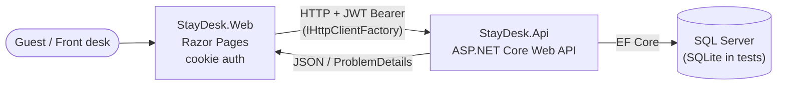

# StayDesk

> Hotel reservation platform built as ASP.NET Core 8 services: overbooking-safe inventory under concurrency, a seasonal/weekend pricing engine, and a reservation state machine with a cancellation policy.

[](https://github.com/edu-tech220/staydesk/actions/workflows/ci.yml)


---

## 📌 Overview

A hotel needs to sell different room types (single, double, suite) **without overbooking them**,
charge different rates depending on **season or weekend**, and track the full lifecycle of every
reservation (pending, confirmed, checked in, checked out, cancelled or no-show) while applying a
**late-cancellation penalty policy**.

StayDesk exposes that logic as a REST service (`StayDesk.Api`) and a website (`StayDesk.Web`)
where a guest searches availability, books and manages their reservations, and front-desk staff
(`FrontDesk` role) confirm, check in/out, cancel or mark reservations as no-show.

## ✨ Key features and business rules

- **Availability search** by date range and number of guests (anonymous, paginated).
- **No overbooking**: per-day inventory per room type, reserved atomically for every night of the stay.
- **Pricing engine**, night by night:
  - a seasonal rate (`SeasonalRate`) covering that date wins, as a fixed nightly price;
  - otherwise the room type's base price, plus a configurable percentage surcharge on Friday and Saturday nights.
- **Booking validation**: check-in cannot be in the past, check-out must be after check-in,
  stays are limited to 30 nights, and the guest count cannot exceed the room type's capacity.
- **Reservation state machine**:
  `Pending → Confirmed → CheckedIn → CheckedOut`, with `Cancelled` (from `Pending` or `Confirmed`)
  and `NoShow` (from `Confirmed`, only after the check-in date has passed). Check-in is not allowed before the check-in date.
- **Cancellation policy** (based on days before check-in):

  | Days before check-in | Penalty |
  |---|---|
  | 3 or more | 0% |
  | 1–2 | 50% |
  | Same day or later | 100% (no refund) |

  Cancelling also releases the reserved inventory.
- **Ownership checks**: guests can only view and cancel their own reservations; `FrontDesk` can act on any.
- **Seasonal rate management** for `FrontDesk` users.

## 🏗️ Architecture



- **StayDesk.Api** – Web API with the business rules (availability, pricing, reservation states),
  EF Core + SQL Server, JWT auth, rate limiting and Swagger.
- **StayDesk.Web** – Razor Pages frontend (HTML/CSS, no heavy JavaScript) that calls the API through
  `IHttpClientFactory`. It shares **no code and no database** with the API: the two are independently
  deployable services, each with its own contracts (DTOs are intentionally duplicated in `StayDesk.Web/ApiClient`).
- **StayDesk.Api.Tests** – xUnit tests for the backend, running against in-memory SQLite (no SQL Server needed).

## 🧠 Technical decisions

### Overbooking control without T-SQL hints

Each room type has one inventory row per day (`RoomTypeDailyInventory`: `RoomTypeId` + `Date` +
`RoomsBooked`). Booking a stay increments that row for every night inside a single transaction, using
a conditional atomic `UPDATE`:

```sql
UPDATE RoomTypeDailyInventories
SET RoomsBooked = RoomsBooked + 1
WHERE RoomTypeId = @id AND Date = @date AND RoomsBooked < @totalRooms
```

A conditional `UPDATE` is concurrency-safe without hints such as `UPDLOCK`/`HOLDLOCK`: the engine
locks the row before evaluating the predicate, so two concurrent transactions can never push the
count past the limit. T-SQL hints were deliberately avoided because they are **not portable to SQLite**,
the engine used by the automated tests; this pattern behaves the same on both.

It is verified by a real concurrency test (`ConcurrencyTests`) that fires 8 simultaneous bookings
against a room type with capacity for 2 and asserts that exactly 2 succeed while the rest get
`409 Conflict`. If the day's row does not exist yet, it is inserted in the same transaction, with a
retry if another transaction won the creation race (unique index violation on `RoomTypeId + Date`).

### Optimistic concurrency on reservations

Every state transition checks the current status and regenerates a `ConcurrencyStamp` (`Guid`)
configured as an EF Core concurrency token. A concurrent modification raises
`DbUpdateConcurrencyException`, which is returned as `409 Conflict`. A code-generated GUID was chosen
over SQL Server `rowversion` because `rowversion` is not portable to SQLite.

### Consistent error handling

A central middleware translates domain exceptions (validation, not found, forbidden, conflict) into
`application/problem+json` responses with the matching HTTP status (400 / 403 / 404 / 409).

### Security

- JWT signed with HMAC-SHA256, issued by `StayDesk.Api`.
- Passwords hashed with ASP.NET Core's built-in `PasswordHasher<T>` (PBKDF2).
- **Rate limiting** on the booking endpoint: fixed window of 5 requests/minute, partitioned per user
  (or per IP when anonymous) so one abusive client does not consume everyone else's quota.
- CORS restricted to an allow-list of origins (intended for a future browser client calling the API
  directly; the current frontend calls it server-side, so it does not depend on CORS).
- The frontend stores the JWT as a claim inside its own HTTP-only authentication cookie, not in `localStorage`.

### Tests without external services

`StayDesk.Api.Tests` replaces SQL Server with **shared-cache in-memory SQLite**
(`Mode=Memory;Cache=Shared`): each `DbContext` opens its own connection (as in production) but all of
them see the same database, which makes it possible to test real concurrency between simultaneous
requests through `WebApplicationFactory`. `Default Timeout` sets SQLite's `busy_timeout` so concurrent
writers wait instead of failing immediately with "database is locked". A test clock (`TestClock`) makes
date-dependent rules deterministic.

## 🧰 Tech stack

| Layer | Technology |
|---|---|
| Language / runtime | C# / .NET 8 |
| Backend | ASP.NET Core Web API (controllers), Swagger (Swashbuckle) |
| Frontend | ASP.NET Core Razor Pages, cookie authentication |
| Data access | Entity Framework Core 8 (migrations) |
| Database | SQL Server 2022 (SQLite in-memory for tests) |
| Auth | JWT Bearer, `PasswordHasher<T>` (PBKDF2) |
| Resilience | ASP.NET Core rate limiting, optimistic concurrency |
| Testing | xUnit, `WebApplicationFactory` |
| DevOps | Docker, Docker Compose, GitHub Actions |

## 🚀 Getting started

### With Docker (recommended)

```bash
docker compose up --build
```

| Service | URL |
|---|---|
| Web (Razor Pages) | http://localhost:5100 |
| API | http://localhost:5080 |
| SQL Server | `localhost:1433` |

The containers run with `ASPNETCORE_ENVIRONMENT=Production`, so Swagger UI is not exposed there
(see the local setup below). The SQL Server password in `docker-compose.yml` and `appsettings.json`
(`StayDesk#2026_Dev`) is for local development only; a real deployment would inject it through
environment variables or a secrets manager.

### Locally with the .NET SDK

Requires the .NET 8 SDK and a SQL Server instance reachable at `localhost:1433`
(e.g. `docker compose up sqlserver`).

```bash
# Backend  -> http://localhost:5080  (Swagger UI at /swagger)
dotnet run --project StayDesk.Api

# Frontend -> http://localhost:5000  (in another terminal)
dotnet run --project StayDesk.Web
```

EF Core migrations are applied and seed data is loaded automatically when `StayDesk.Api` starts
(except in the `Testing` environment used by the tests). The seed includes three room types and a
front-desk user:

| Email | Password | Role |
|---|---|---|
| `frontdesk@staydesk.local` | `FrontDesk#2026` | FrontDesk |

Guests can sign up through the **Register** page (or `POST /api/auth/register`).

## 🧪 Running tests

```bash
dotnet test StayDesk.Api.Tests/StayDesk.Api.Tests.csproj
```

**43 test cases** (38 `[Fact]` + 2 `[Theory]` with 5 data rows), no SQL Server or Docker required. They cover:

- pricing (seasonal and weekend rates);
- availability search and pagination;
- authentication and role-based authorization;
- the full reservation state machine;
- the cancellation policy by days before check-in;
- a concurrency test that fires simultaneous bookings to prove a room type is never overbooked.

CI runs the same suite on every push and pull request to `main` (`.github/workflows/ci.yml`).

## 🔌 API endpoints

| Method | Route | Auth | Description |
|---|---|---|---|
| `POST` | `/api/auth/register` | Anonymous | Register a guest account, returns a JWT |
| `POST` | `/api/auth/login` | Anonymous | Log in, returns a JWT |
| `GET` | `/api/room-types` | Anonymous | List room types (paginated) |
| `GET` | `/api/room-types/availability?checkIn=&checkOut=&guests=` | Anonymous | Search availability and price for a stay (paginated) |
| `GET` | `/api/room-types/{roomTypeId}/seasonal-rates` | FrontDesk | List seasonal rates of a room type |
| `POST` | `/api/room-types/{roomTypeId}/seasonal-rates` | FrontDesk | Add a seasonal rate |
| `POST` | `/api/reservations` | Authenticated · rate-limited | Create a reservation |
| `GET` | `/api/reservations/mine` | Authenticated | Current user's reservations (paginated) |
| `GET` | `/api/reservations` | FrontDesk | All reservations (paginated, filterable) |
| `GET` | `/api/reservations/{id}` | Owner or FrontDesk | Reservation details |
| `PUT` | `/api/reservations/{id}/confirm` | FrontDesk | `Pending → Confirmed` |
| `PUT` | `/api/reservations/{id}/check-in` | FrontDesk | `Confirmed → CheckedIn` |
| `PUT` | `/api/reservations/{id}/check-out` | FrontDesk | `CheckedIn → CheckedOut` |
| `PUT` | `/api/reservations/{id}/cancel` | Owner or FrontDesk | Cancel and apply the penalty policy |
| `PUT` | `/api/reservations/{id}/no-show` | FrontDesk | `Confirmed → NoShow` |

Sample requests are available in `StayDesk.Api/StayDesk.Api.http`.

## 📁 Project structure

```
StayDesk.sln
├── StayDesk.Api/                 # Backend Web API
│   ├── Controllers/              # Auth, RoomTypes, Reservations
│   ├── Services/                 # Auth, Availability, Pricing, Reservations, RoomTypes
│   ├── Domain/                   # Entities and enums
│   ├── Data/                     # DbContext, migrations, seeder
│   ├── Dtos/                     # Request/response contracts
│   ├── Middleware/               # Exception -> ProblemDetails
│   └── Dockerfile
├── StayDesk.Web/                 # Razor Pages frontend
│   ├── ApiClient/                # Typed HTTP client + its own DTOs
│   ├── Pages/                    # Account, Reservations, Admin
│   └── Dockerfile
├── StayDesk.Api.Tests/           # xUnit tests (Unit/ + Integration/)
├── docker-compose.yml            # API + Web + SQL Server
└── .github/workflows/ci.yml      # Build + test
```
